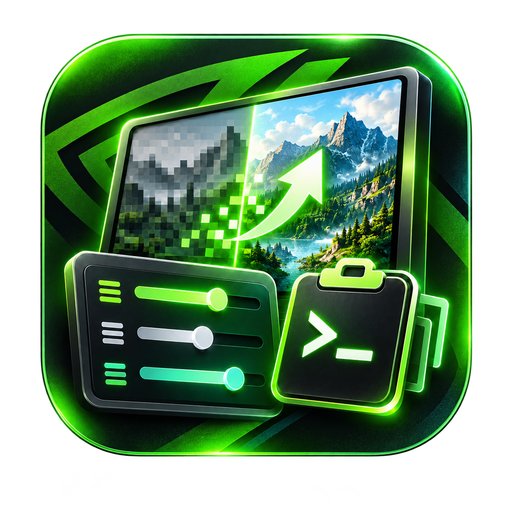
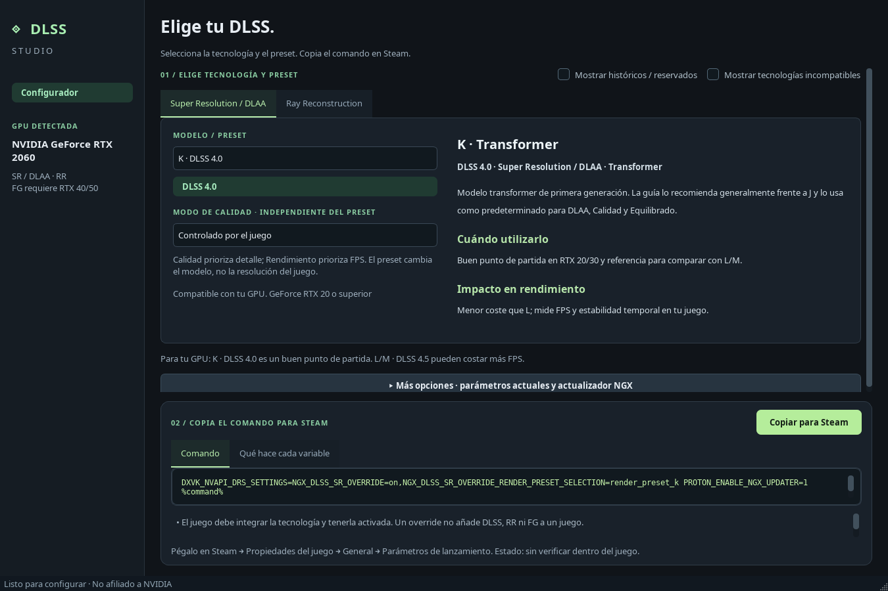

# DLSS Studio · 1.0.0

**English** | [Español](README_ES.md)

**Choose DLSS presets and copy launch commands for your games.**

A Spanish-language desktop application for Steam/Linux/Proton. Choose a technology, preset and quality mode, copy the command and paste it into Steam launch options. It does not modify Steam or replace DLLs. Not affiliated with NVIDIA or Valve.



## Download

Get [version 1.0.0](https://github.com/N3ruk/DLSS-Studio/releases/tag/v1.0.0):

| Format | Usage |
| --- | --- |
| [x86_64 AppImage](https://github.com/N3ruk/DLSS-Studio/releases/download/v1.0.0/DLSS-Studio-1.0.0-x86_64.AppImage) | Portable; no installation |
| [amd64 DEB](https://github.com/N3ruk/DLSS-Studio/releases/download/v1.0.0/dlss-studio_1.0.0_amd64.deb) | Compatible Debian, Ubuntu and Linux Mint systems |

Both include **Python, Qt, support libraries and fonts**; no separate Python/PySide6 installation or application-dependency download is needed.

Requires x86_64 Linux with **glibc 2.35+** and an X11/Wayland desktop, such as Ubuntu 22.04+, Debian 12+ or Linux Mint 21+. Not for ARM, 32-bit or Alpine/musl. DEB requires a Debian-compatible system. NVIDIA drivers, `nvidia-smi`, Steam and Proton are not included.

### AppImage

```sh
chmod +x DLSS-Studio-1.0.0-x86_64.AppImage
./DLSS-Studio-1.0.0-x86_64.AppImage
# Without FUSE:
./DLSS-Studio-1.0.0-x86_64.AppImage --appimage-extract-and-run
```

### DEB

Open the file with your distribution's package installer. Installs under `/opt/dlss-studio` and adds **DLSS Studio** to the application menu. Only glibc is declared as a system dependency; application dependencies are bundled. It does not install drivers or invoke pip.

Verify downloads using `SHA256SUMS` from the same release:

```sh
sha256sum -c SHA256SUMS
```

## Use

1. GPU detection is automatic and shown discreetly in the sidebar.
2. Choose technology and preset: **J/K · DLSS 4.0**, **L/M · DLSS 4.5**.
3. Optionally set Quality/Performance independently of the model.
4. Under **Más opciones** (More options), preserve current parameters or disable the NGX updater.
5. Click **Copiar para Steam** (Copy for Steam), then paste into Properties → General → Launch Options.
6. Enable the corresponding technology inside the game.

One screen, without profiles, context forms or wiki pages. FG/MFG compatibility is validated automatically against the GPU family.

## Included

- Super Resolution/DLAA: J/K, L/M, automatic and historical models.
- Ray Reconstruction: models/generation identified independently of SR.
- Frame Generation: FG, MFG and dynamic mode according to supported hardware.
- NVIDIA FG blocked on RTX 20/30; MFG/dynamic require RTX 50.
- Existing parameter preservation, DRS setting composition and conflict detection.
- Offline referenced catalog; the application never executes generated commands.

## Scope

The generation label describes the requested model/function, not proof of which DLL/model a game actually loads. Applying a preset depends on the game, Proton, NGX, DXVK-NVAPI and driver. **In-game application has not been verified.**

Historical CNN letters are shown as **DLSS 2.x / 3.x**, without assigning exact versions. RR transformer is labeled **DLSS 4.0+ family**; letters from different technologies are not equated. Automatic does not force a generation.

Proton's NGX updater may download components when a game starts and can be disabled under More options. This application itself does not install them. Complex shell strings are not executed or silently reinterpreted. On multi-GPU systems, the first `nvidia-smi` row is shown with a notice.

## Development

Python 3.10+ and PySide6 or PyQt6:

```sh
python3 -m venv .venv
.venv/bin/pip install -e '.[pyside]'
./run.sh
QT_QPA_PLATFORM=offscreen .venv/bin/python -m unittest discover -s tests -v
```

Development menu entry, without sudo: `python3 tools/install_user.py`.

- [Building/verifying AppImage and DEB](docs/BUILD.md) · [Español](docs/es/BUILD.md)
- `dlss_studio/core.py`: hardware, validation and command generation.
- `dlss_studio/ui.py`: Qt interface.
- `tools/build_catalog.py`: catalog generation; review sources before editing.
- `docs/sources/`: technical references and catalog evidence.
- [Release status and verification](docs/ESTADO.md) · [Español](docs/es/ESTADO.md)

## License

Original code: [BSD-3-Clause](LICENSE). See [third-party components](THIRD_PARTY.md). Trademarks remain owned by their holders.
