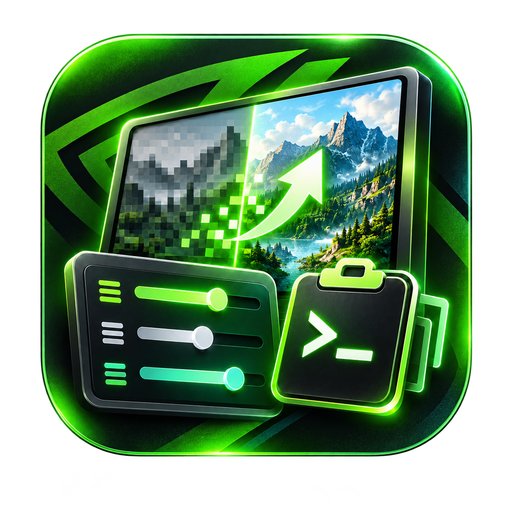
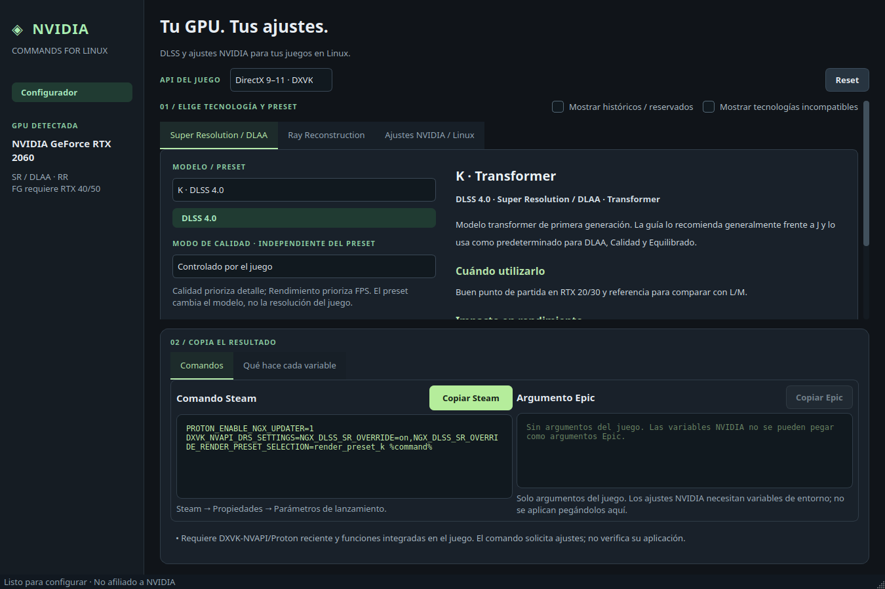
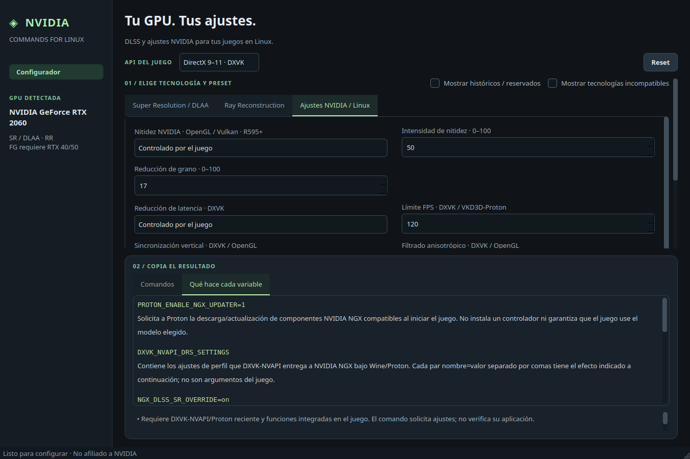

# NVIDIA Commands for Linux · 2.0.0

[English](README.md) | **Español**

**Genera comandos gráficos NVIDIA para Linux. Antes: DLSS Studio.**

Elige modelos DLSS y ajustes con una ruta Linux documentada. La interfaz conserva el diseño oscuro/verde, detecta la GPU y filtra controles por generación y API gráfica. **No es NVIDIA App ni está afiliada a NVIDIA, Valve o Epic Games.**



## Descargar

[Release 2.0.0](https://github.com/N3ruk/NVIDIA-Commands-for-Linux/releases/tag/v2.0.0):

- [AppImage x86_64](https://github.com/N3ruk/NVIDIA-Commands-for-Linux/releases/download/v2.0.0/NVIDIA-Commands-for-Linux-2.0.0-x86_64.AppImage).
- [DEB amd64 autocontenido](https://github.com/N3ruk/NVIDIA-Commands-for-Linux/releases/download/v2.0.0/nvidia-commands-for-linux_2.0.0_amd64.deb).

Incluyen Python, Qt, bibliotecas, fuentes y licencias. Requieren GNU/Linux x86_64 con **glibc 2.35+** y escritorio X11/Wayland: Ubuntu 22.04+, Debian 12+, Mint 21+. No ARM, 32 bits, musl ni Linux universal. No incluyen controladores, Steam, Epic o Proton. El configurador no requiere instalar Gamescope ni MangoHud.

```sh
chmod +x NVIDIA-Commands-for-Linux-2.0.0-x86_64.AppImage
./NVIDIA-Commands-for-Linux-2.0.0-x86_64.AppImage
# Sin FUSE:
./NVIDIA-Commands-for-Linux-2.0.0-x86_64.AppImage --appimage-extract-and-run
```

Abre el DEB con el instalador de paquetes. Se instala en `/opt/nvidia-commands-for-linux`; declara la sustitución del paquete `dlss-studio` sin borrar perfiles antiguos. El acceso se llama **NVIDIA Commands for Linux**. Comprueba los archivos con `SHA256SUMS` de la release.

## Opciones incluidas

- **DLSS SR/DLAA:** J/K · 4.0, L/M · 4.5, automático/históricos, calidad independiente y escala interna personalizada 33–100 %.
- **Ray Reconstruction:** modelo, modo y escala independientes; necesita integración en el juego.
- **FG/MFG:** RTX 40: FG 2×; RTX 50: hasta 6× y MFG dinámico. El modo dinámico genera el valor DRS `dynamic` correcto.
- **Smooth Motion:** interpolación del driver; bases documentadas RTX 50 **580.65.06+**, RTX 40 **580.95.05+**, capa `VK_LAYER_NV_present` y Vulkan x86_64. No combinar con FG integrado.
- **Nitidez NVIDIA:** filtro OpenGL/Vulkan, intensidad y reducción de grano; base documentada R595+. No activa escalado NIS.
- **Latencia/FPS:** puente Reflex Vulkan opcional, reducción de latencia DXVK, límites DXVK/VKD3D y VSync según API.
- **Texturas/pantalla:** anisotropía DXVK/OpenGL, LOD bias DXVK; VRR, multihilo, caché de shaders y permiso FXAA para OpenGL.
- **Indicadores:** indicador gráfico NVIDIA e indicadores DLSS con opción explícita para quitarlos.
- **Alcance gráfico:** sin controles de Gamescope/NIS/FSR, MangoHud/DXVK HUD, PRIME ni señalización HDR genérica. Las utilidades externas de lanzamiento corresponden a SteamCommandGen.
- **Reset:** borra parámetros importados, overrides y ambas salidas; conserva la GPU detectada y no modifica el sistema. Los indicadores persistentes ya aplicados en Wine necesitan ejecutar una vez su opción Desactivar.
- **Explicaciones:** cada variable y su valor seleccionado se describen por separado, incluidos los ajustes internos DRS/DXVK. Los valores importados desconocidos se identifican sin inventar su efecto.

Los juegos **nativos de Linux no admiten estos overrides de presets DLSS**. Al elegir API nativa se dejan las selecciones exclusivas de Proton controladas por el juego. Vulkan nativo admite el indicador SR temporal y las opciones compatibles del controlador.




## Steam

1. Selecciona la API real del juego. Las dos salidas permanecen visibles a la vez.
2. Elige ajustes. En **Más opciones** puedes conservar parámetros actuales sencillos.
3. Copia en Steam → Propiedades del juego → General → Parámetros de lanzamiento.
4. Activa las funciones integradas dentro del juego. Para Smooth Motion, desactiva FG en el juego.

Se genera un único `%command%`; se conservan argumentos, wrappers y ajustes ajenos cuando pueden combinarse. Las entradas complejas/conflictivas se rechazan: nunca se ejecutan.

## Argumento Epic — junto a Comando Steam

Las dos salidas están visibles a la vez y tienen botones de copia independientes. **Comando Steam** contiene el comando completo para Steam. **Argumento Epic** contiene únicamente los argumentos existentes del juego posteriores a `%command%`, como `-dx12`, para el campo de argumentos adicionales de Epic. Puedes introducirlos en **Más opciones**, por ejemplo `%command% -dx12`.

**Las variables NVIDIA no son argumentos de Epic.** Elegir DLSS, Smooth Motion o nitidez no genera un argumento Epic equivalente: esa caja queda vacía si no has añadido argumentos del juego. Los wrappers Steam no se convierten. La interfaz no ofrece arranque de sesión del launcher.

En el cliente oficial Preview **0.109.0+ge564459** no se verificó un campo de variables por juego. Iniciar el launcher completo con variables sigue siendo una técnica experimental aparte, no una salida de la interfaz actual; su herencia hasta un juego autenticado sigue sin comprobarse. [Investigación y límites](docs/es/EPIC.md).

## Alcance

Generador local y sin conexión: no inicia juegos, modifica Steam/Epic, sustituye DLL, instala controladores ni accede a credenciales. El actualizador NGX de Proton puede descargar componentes cuando lances el juego. Los indicadores DLSS bajo Wine persisten en el registro del prefijo: ejecuta una vez un comando con **Desactivar indicador** para quitarlos.

No se dispone de prueba física con RTX 5070 ni de verificación de modelos/FPS dentro de juegos. Las pruebas RTX 5070 son simuladas; la detección real se comprobó con RTX 2060. [Verificación](docs/VERIFICATION.md).

La [comparación completa con NVIDIA App](docs/es/RESEARCH.md) distingue las funciones añadidas de RTX HDR, Freestyle, DLDSR, optimización automática, ShadowPlay, gestión de drivers, calibración y overclock. Estas últimas no se presentan como variables Linux equivalentes.

## Desarrollo

Python 3.10+ con PySide6 o PyQt6:

```sh
python3 -m venv .venv
.venv/bin/pip install -e '.[pyside]'
./run.sh
QT_QPA_PLATFORM=offscreen .venv/bin/python -m unittest discover -s tests -v
```

[Construcción](docs/es/BUILD.md) · [Investigación](docs/es/RESEARCH.md) · [Epic](docs/es/EPIC.md) · [Licencias](THIRD_PARTY_ES.md).

Código original [BSD-3-Clause](LICENSE). Se conserva el icono proporcionado por el propietario. La release e historial DLSS Studio 1.0.0 siguen disponibles.
