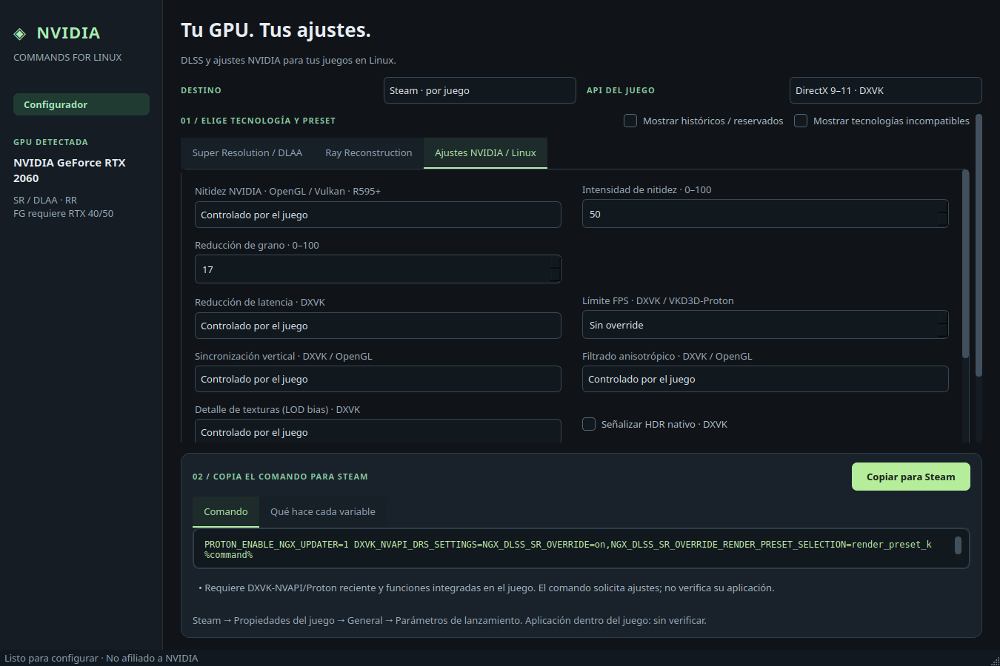

# NVIDIA Commands for Linux · 2.0.0

[English](README.md) | **Español**

**Genera comandos gráficos NVIDIA para Linux. Antes: DLSS Studio.**

Elige modelos DLSS y ajustes con una ruta Linux documentada. La interfaz conserva el diseño oscuro/verde, detecta la GPU y filtra controles por generación y API gráfica. **No es NVIDIA App ni está afiliada a NVIDIA, Valve o Epic Games.**


## Descargar

[Release 2.0.0](https://github.com/N3ruk/NVIDIA-Commands-for-Linux/releases/tag/v2.0.0):

- [AppImage x86_64](https://github.com/N3ruk/NVIDIA-Commands-for-Linux/releases/download/v2.0.0/NVIDIA-Commands-for-Linux-2.0.0-x86_64.AppImage).
- [DEB amd64 autocontenido](https://github.com/N3ruk/NVIDIA-Commands-for-Linux/releases/download/v2.0.0/nvidia-commands-for-linux_2.0.0_amd64.deb).

Incluyen Python, Qt, bibliotecas, fuentes y licencias. Requieren GNU/Linux x86_64 con **glibc 2.35+** y escritorio X11/Wayland: Ubuntu 22.04+, Debian 12+, Mint 21+. No ARM, 32 bits, musl ni Linux universal. No incluyen controladores, Steam, Epic o Proton. Gamescope y MangoHud son dependencias opcionales externas.

```sh
chmod +x NVIDIA-Commands-for-Linux-2.0.0-x86_64.AppImage
./NVIDIA-Commands-for-Linux-2.0.0-x86_64.AppImage
# Sin FUSE:
./NVIDIA-Commands-for-Linux-2.0.0-x86_64.AppImage --appimage-extract-and-run
```

Abre el DEB con el instalador de paquetes. Se instala en `/opt/nvidia-commands-for-linux`; declara la sustitución del paquete `dlss-studio` sin borrar perfiles antiguos. El acceso se llama **NVIDIA Commands for Linux**. Comprueba los archivos con `SHA256SUMS` de la release.

## Opciones incluidas

- **DLSS SR/DLAA:** J/K · 4.0, L/M · 4.5, automático/históricos, calidad independiente y escala interna personalizada 33–100 %.
- **Ray Reconstruction:** modelo, modo y escala independientes; necesita integración en el juego.
- **FG/MFG:** RTX 40: FG 2×; RTX 50: hasta 6× y MFG dinámico. El modo dinámico genera el valor DRS `dynamic` correcto.
- **Smooth Motion:** interpolación del driver; bases documentadas RTX 50 **580.65.06+**, RTX 40 **580.95.05+**, capa `VK_LAYER_NV_present` y Vulkan x86_64. No combinar con FG integrado.
- **Nitidez NVIDIA:** filtro OpenGL/Vulkan, intensidad y reducción de grano; base documentada R595+. No activa escalado NIS.
- **Latencia/FPS:** puente Reflex Vulkan opcional, reducción de latencia DXVK, límites DXVK/VKD3D y VSync según API.
- **Texturas/pantalla:** anisotropía DXVK/OpenGL, LOD bias DXVK, señalización HDR nativo DXVK; VRR, multihilo, caché de shaders y permiso FXAA para OpenGL.
- **Indicadores:** DXVK HUD, MangoHud externo, indicador gráfico NVIDIA e indicadores DLSS con opción explícita para quitarlos.
- **GPU híbrida:** PRIME render offload opcional.
- **Gamescope opcional:** NIS/FSR 1 espacial y supersampling para Steam. No equivalen a DSR/DLDSR del driver ni a DLSS temporal. Se bloquea la combinación automática con Smooth Motion para no activar la capa sobre el compositor.

Los juegos **nativos de Linux no admiten estos overrides de presets DLSS**. Al elegir API nativa se dejan las selecciones exclusivas de Proton controladas por el juego. Vulkan nativo admite el indicador SR temporal y las opciones compatibles del controlador.



## Steam

1. Selecciona **Steam · por juego** y la API real del juego.
2. Elige ajustes. En **Más opciones** puedes conservar parámetros actuales sencillos.
3. Copia en Steam → Propiedades del juego → General → Parámetros de lanzamiento.
4. Activa las funciones integradas dentro del juego. Para Smooth Motion, desactiva FG en el juego.

Se genera un único `%command%`; se conservan argumentos, wrappers y ajustes ajenos cuando pueden combinarse. Las entradas complejas/conflictivas se rechazan: nunca se ejecutan.

## Epic oficial Linux Preview — por sesión, experimental

Se investigó el cliente oficial nativo **0.109.0+ge564459**. Su campo por juego es de **argumentos adicionales**, no de comandos Steam.

1. Selecciona **Epic oficial · sesión del launcher** y su AppImage/binario mediante una ruta absoluta.
2. Opcionalmente pega un enlace `com.epicgames.launcher://apps/…` del juego.
3. Cierra Epic completamente y ejecuta el comando generado **en una terminal**. Sus variables afectan a **toda esa sesión**, no a un perfil aislado por juego.
4. Si hay argumentos del juego, usa **Copiar argumentos Epic** y pégalos por separado en los ajustes del juego.

Nunca se envía `%command%` a Epic. Los wrappers Steam se bloquean; no se envuelve el launcher como si fuera el juego. **La herencia de variables hasta un juego con cuenta no se ha verificado**. Los parámetros de Proton dependen del runtime que use realmente Epic. [Investigación y límites](docs/es/EPIC.md).

## Alcance

Generador local y sin conexión: no inicia juegos, modifica Steam/Epic, sustituye DLL, instala controladores ni accede a credenciales. El actualizador NGX de Proton puede descargar componentes cuando lances el juego. Los indicadores DLSS bajo Wine persisten en el registro del prefijo: ejecuta una vez un comando con **Desactivar indicador** para quitarlos.

No se dispone de prueba física con RTX 5070 ni de verificación de modelos/FPS dentro de juegos. Las pruebas RTX 5070 son simuladas; la detección real se comprobó con RTX 2060. [Verificación](docs/VERIFICATION.md).

La [comparación completa con NVIDIA App](docs/es/RESEARCH.md) distingue las funciones añadidas de RTX HDR, Freestyle, DLDSR, optimización automática, ShadowPlay, gestión de drivers, calibración y overclock. Estas últimas no se presentan como variables Linux equivalentes.

## Desarrollo

Python 3.10+ con PySide6 o PyQt6:

```sh
python3 -m venv .venv
.venv/bin/pip install -e '.[pyside]'
./run.sh
QT_QPA_PLATFORM=offscreen .venv/bin/python -m unittest discover -s tests -v
```

[Construcción](docs/es/BUILD.md) · [Investigación](docs/es/RESEARCH.md) · [Epic](docs/es/EPIC.md) · [Licencias](THIRD_PARTY_ES.md).

Código original [BSD-3-Clause](LICENSE). Se conserva el icono proporcionado por el propietario. La release e historial DLSS Studio 1.0.0 siguen disponibles.
